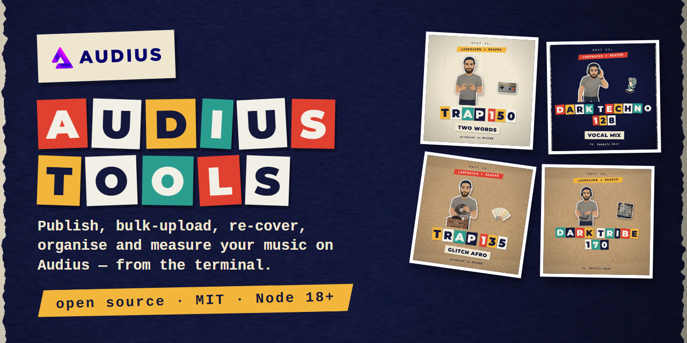

<div align="center">



<br>

<a href="https://audius.co"></a>

### The missing command line for independent artists on Audius

Publish tracks, bulk-upload a whole album folder, swap cover art, build playlists and albums,<br>
read your plays, favorites and reposts as a table or CSV — with the official **Audius SDK**, from your terminal.

[](LICENSE)
[](package.json)
[](https://www.npmjs.com/package/@audius/sdk)
[](#safety-first)
[](CONTRIBUTING.md)

[Quick start](#quick-start) · [Commands](#commands) · [Bulk upload](#bulk-upload-a-whole-release) · [Cover art](#cover-art-generator) · [FAQ](#faq)

</div>

---

## Why

Audius is a free, artist-owned music streaming platform with an open API — but uploading ten beats, fixing a typo in a
title or changing a cover still means clicking through the web app one track at a time. **audius-tools** turns that into
one command, scriptable, repeatable and safe:

```text
$ audius-tools stats
id       title                                         plays  favs  reposts  comments  released
───────  ────────────────────────────────────────────  ─────  ────  ───────  ────────  ──────────
dREdxy4  Dark Tribe 170 (ft. Daniela Dair)                21    12       12         0  2026-11-18
rbE2Jgg  Trap 140 — First Session                         20     9       12         0  2026-11-18
mEd4Omy  Trap 150 — Two Words                             15    10       12         0  2026-11-18

@benmallessa · 8 tracks · 90 plays · 88 favorites · 97 reposts · 4 followers
```

## Quick start

```bash
git clone https://github.com/mohamed-amine-ben-mallessa/audius-tools.git
cd audius-tools && npm install
npm link                      # optional: exposes the `audius-tools` command everywhere

audius-tools trending --genre Techno     # works right away, no account needed
```

To write (upload, edit, playlists…), create an app on Audius → **Settings → Create Apps**, then:

```bash
cp .env.example .env          # AUDIUS_API_KEY, AUDIUS_BEARER_TOKEN, AUDIUS_HANDLE
audius-tools check            # ✓ API reachable · ✓ your app is authorised to write on this account
```

## Commands

| Group | Command | What it does |
|---|---|---|
| **Account** | `check` | key + token work, app authorised to write on your account |
| | `me [--handle x]` | followers, following, tracks, playlists, albums |
| **Your tracks** | `list [--json \| --csv[=file]]` | every track with id, length, plays and link |
| | `stats [--json \| --csv[=file]]` | plays, favorites, reposts, comments per track + totals |
| | `upload --file f.mp3 --title "…" --genre Techno [--cover c.jpg] [--mood] [--tags] [--desc] [--unlisted] [--downloadable]` | publish one track |
| | `bulk manifest.json [--pause 3] [--force]` | publish a whole folder; **resumes safely**, never uploads twice |
| | `edit --track <id> [--title\|--genre\|--mood\|--tags\|--desc\|--license] [--unlisted\|--public]` | fix metadata after release |
| | `artwork --track <id> --cover c.jpg` | replace a published track's cover |
| | `delete --track <id> --yes --confirm <id>` | permanent, double-confirmed |
| | `links [--track <id>] [--md]` | track page, embeddable player `<iframe>`, Markdown list for your bio / README |
| **Playlists & albums** | `playlist --title "…" --tracks id1,id2 [--cover] [--private]` | create a playlist |
| | `album --title "…" --tracks id1,id2 [--cover]` | create an album |
| | `playlist-add` / `playlist-remove` · `collections` | edit and list them |
| **Discover** *(no account)* | `trending [--genre] [--time week\|month\|year\|allTime] [--underground]` | what's hot on Audius |
| | `search <words> [--genre] [--users]` | tracks or artists |
| | `comments --track <id>` | read the comments on any track |
| | `genres` | valid `--genre` / `--mood` values |

Run `audius-tools help` for the full reference.

## Safety first

- **Every write is a dry run** until you add `--yes`: you see exactly what would be sent.
- `delete` needs `--yes` **and** `--confirm <id>`, and refuses tracks that are not yours.
- Credentials are read only from `.env` (or the file in `AUDIUS_ENV`) and are **never printed**. API errors show the
  server's message, never your token.
- Only upload music you own, and check the licence of every sample or acapella you used.

## Bulk upload a whole release

```json
{
  "defaults": { "genre": "Hip-Hop/Rap", "mood": "Aggressive", "tags": "trap,beat", "unlisted": false },
  "tracks": [
    { "file": "audio/trap-150.mp3", "title": "Trap 150 — Two Words", "cover": "covers/trap-150.jpg" },
    { "file": "audio/dark-techno-128.mp3", "title": "Dark Techno 128 — Vocal Mix", "genre": "Techno", "cover": "covers/techno.jpg" }
  ]
}
```

```bash
audius-tools bulk examples/manifest.json          # plan
audius-tools bulk examples/manifest.json --yes    # publish (finished tracks are logged in published.json and skipped next time)
```

## Cover art generator

`covers.py` makes square 1400 × 1400 covers in a cut-paper collage style — ransom-letter title, tape banner, your character
or object cutout and a prop — from a small JSON file. Then push them with `audius-tools artwork`.

<div align="center">
   
</div>

```bash
pip install playwright pillow && python -m playwright install chromium
python covers.py examples/covers.json --out covers/        # → covers/<id>.jpg + covers/planche.jpg (contact sheet)
audius-tools artwork --track <id> --cover covers/<id>.jpg --yes
```

## FAQ

**Is there an official Audius CLI?** Audius publishes an SDK (`@audius/sdk`) and a REST API, not an artist CLI.
audius-tools is a thin, open-source command line on top of that official SDK.

**How do I upload music to Audius from the command line?** `audius-tools upload --file song.mp3 --title "…" --genre Electronic --yes`,
or `audius-tools bulk manifest.json --yes` for many tracks at once.

**How do I change the cover art of a track already on Audius?** `audius-tools artwork --track <id> --cover new.jpg --yes`.

**Can I export my Audius stats?** `audius-tools stats --csv=stats.csv` (plays, favorites, reposts, comments per track).

**Do I need an account to use it?** No for `trending`, `search`, `comments`, `me`, `list`, `stats` of any public artist;
yes (API key + bearer token) for anything that writes.

## Made with it

The covers above belong to [@benmallessa](https://audius.co/benmallessa), beats made in REAPER with an AI assistant and
[LoopHaven](https://github.com/mohamed-amine-ben-mallessa/loop-haven) (open-source Looperman loop finder) — the story is told
in the *LoopHaven × REAPER* video series.

## Contributing

Issues and pull requests are welcome — see [CONTRIBUTING.md](CONTRIBUTING.md). Ideas: scheduled releases, stems,
remix contests, comment replies, a `watch` command for new plays.

## License

[MIT](LICENSE) © Mohamed Amine Ben Mallessa. Not affiliated with or endorsed by Audius; the Audius name and logo are
trademarks of their owner, used only to identify the platform this tool works with.
